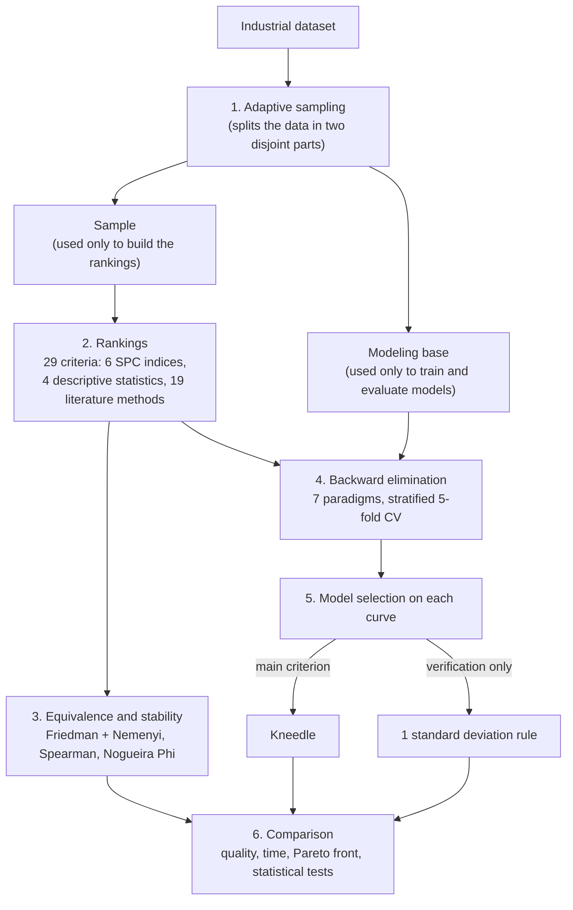

# spc-feature-selection

**Feature ranking and selection guided by Statistical Process Control (SPC) indices: code, data and results for replication.**


This repository accompanies the manuscript *"Integrating Machine Learning and Statistical Process Control: Feature Selection and Ranking"*, submitted to a journal under double-anonymized peer review. It contains the notebooks, the public input data of case study 1, and the aggregated result spreadsheets of both case studies, so that every table and figure of the manuscript can be traced to a file and regenerated.

> **Notice on the data of case study 2 (off-road trucks).** The case study 2 dataset belongs to the company that provided it and is **confidential**. It is **not public** and **is not included in this repository**; neither the raw records nor the samples derived from them are distributed. Researchers who need the data to replicate or extend the analysis must contact the corresponding author to **start the process of requesting authorization for release of the data from the company**. Release depends on the company's approval. During the double-anonymized review, requests are forwarded through the journal editor; the corresponding author's address will be made available after the review. The data of case study 1 (SECOM) are public and are included.

---

## Table of contents

1. [Overview](#1-overview)
2. [Method](#2-method)
3. [Case studies](#3-case-studies)
4. [Repository structure](#4-repository-structure)
5. [Environment and installation](#5-environment-and-installation)
6. [Replication: step by step](#6-replication-step-by-step)
7. [Result indicators and output files](#7-result-indicators-and-output-files)
8. [Main findings reported in the manuscript](#8-main-findings-reported-in-the-manuscript)
9. [Reproducibility notes](#9-reproducibility-notes)
10. [Data availability](#10-data-availability)
11. [License and citation](#11-license-and-citation)

---

## 1. Overview

Industrial datasets often contain hundreds of sensors or operational states, and choosing which of them to monitor usually relies on generic filter methods (ANOVA, mutual information, ReliefF, among others). This work evaluates an alternative: ranking features with metrics whose formulas are inspired by SPC indices (process capability and control-chart indices), computed only on the records of a **reference class**, and combining the resulting rankings with backward elimination.

The research question is whether SPC-inspired indices can guide feature ranking and selection. The proposal is compared with **19 consolidated feature selection methods from the literature** and **4 descriptive statistics**, on **7 classification paradigms**, in **two industrial case studies** with different class structures (binary fault detection and five-class operating-shift classification). The comparison covers predictive quality, number of selected features, stability of the selected subsets, computational cost and the quality-versus-size trade-off (Pareto front).

The SPC formulas are used only as inspiration to build ranking metrics. The study does not assess process capability, and the specification limits are defined by the data, not by engineering requirements.

## 2. Method

The method is identical in both case studies and is implemented as a sequence of notebooks. Each stage uses the output of the previous one.



### 2.1 Adaptive sampling (notebook 1)

The dataset is split into two disjoint parts: a **sample**, used only to compute the rankings, and a **modeling base** (the remaining records), used only to train and evaluate the classifiers. Keeping them disjoint prevents selection bias.

The sample is built incrementally, starting with 100 records and adding one record per iteration. After each iteration, the sample is considered sufficient for a feature when the width of the 95% confidence interval of its standard deviation, computed with the chi-square distribution, is at most 20%. Since this width depends only on the number of records, the criterion can only be met from **197 records** onwards. Sampling stops when all features satisfy the criterion or when the sample reaches **50% of the dataset** (cap). This follows the logic of progressive sampling. Missing values are replaced by the median of each feature computed on the sample (missing completely at random is assumed). Records are kept in order, because the short-term standard deviation of Cp and Cpk is estimated from consecutive readings.

### 2.2 Rankings (notebook 2)

On the sample, the `d` features are ordered by **29 criteria** in three groups. In every ranking, the feature with the largest criterion value takes the first position, except for LaplacianScore and GiniIndex, where smaller values indicate more relevant features.

**Proposal: SPC-inspired indices (6 rankings).** They are computed only on the records of the reference class. The specification limits are LSL and USL = the **1st and 99th percentiles** of each feature in the reference class.

- Capability indices:
  - `Cp = (USL - LSL) / (6 * sigma_c)`
  - `Cpk = min(USL - mean, mean - LSL) / (3 * sigma_c)`
  - `Pp = (USL - LSL) / (6 * sigma_l)`
  - `Ppk = min(USL - mean, mean - LSL) / (3 * sigma_l)`

  where `sigma_l` is the long-term standard deviation (all readings) and `sigma_c = MRbar / d2` is the short-term standard deviation, estimated from the mean moving range between consecutive readings with `d2 = 1.128`. A feature with constant values has an undefined index (NaN) and is placed at the end of the ranking.
- Control-chart indices: a reading is a defect when it lies more than one standard deviation from the feature mean. With `d_ij = 1` when reading `i` of feature `j` is out of range and `D_i` the number of features out of range in reading `i`:
  - `np_j = sum_i d_ij` and `p_j = np_j / n`
  - `c_j = sum_i d_ij * D_i` and `u_j = c_j / n`

Eight indices are computed, but `np` and `u` differ from `p` and `c` only by a positive constant, so they produce identical orderings. Only six (`Cp, Cpk, Pp, Ppk, p, c`) enter the comparison. Notebook 2 also writes the `_Normalizado`, `np` and `u` versions, which are used only in the equivalence analysis of notebook 3.

**Literature (19 rankings).** Sixteen supervised methods use all sample records with a binary label (reference class versus the rest), and three unsupervised methods use only the reference-class records.

| Family | Methods |
|---|---|
| Statistical tests between classes | ANOVA, FScore_ANOVA, TScore, FisherScore, Kolmogorov-Smirnov (KS), Chi2 |
| Correlation with the label | Pearson, Spearman, Kendall |
| Information theory and impurity | InformationGain, GainRatio, SymmetricalUncertainty, ApproxMIC, GiniIndex |
| Distance and neighborhood | ReliefF, HellingerDistance |
| Unsupervised (reference class only) | LaplacianScore, SPEC, SVDEntropy |

**Descriptive statistics (4 rankings).** Computed on the same reference-class records: range divided by standard deviation (AmplitudeSigma), interquartile range divided by standard deviation (IQRSigma), absolute skewness (Assimetria) and absolute kurtosis (Curtose). The `_BaseCompleta` versions (all classes) are also written by notebook 2 but are excluded from the analyses, because they use a different population.

### 2.3 Equivalence between rankings (notebook 3)

Two analyses answer different questions and are applied to all pairs of rankings:

- **Friedman test followed by Nemenyi post-hoc test**: whether the methods differ in the positions they assign to the features. Each feature is a block and the measure is its position in each ranking. A pair is *statistically equivalent* when the Nemenyi p-value is greater than 0.05. Absence of difference is lack of evidence, not proof of identity.
- **Spearman correlation (rho)** between the positions of the features in two rankings. Agreement bands: strong, 0.70 to 1.00; moderate, 0.30 to 0.69; weak, below 0.30.

With 29 rankings there are 29 x 28 / 2 = 406 distinct pairs. Each group of pairs is summarized by the number of equivalent pairs and the median rho.

### 2.4 Stability of the rankings (notebook 8)

Stability is measured with the **Nogueira index (Phi)**. Using `M = 100` stratified subsamples of 50% of the sample (without replacement), each ranking is recomputed on every subsample and its first `N` features are selected, where `N` is the number of features chosen by the Kneedle criterion on the full sample (kept fixed). With `Z_i` the binary selection vector of subsample `i`, `p_f` the proportion of subsamples that select feature `f`, and `kbar` the mean subset size:

`Phi = 1 - [ (M / (M - 1)) * (1/d) * sum_f p_f (1 - p_f) ] / [ (kbar / d) * (1 - kbar / d) ]`

Phi close to 1 means that practically the same features are selected in any subsample; close to 0, that the selection is as variable as a random choice. Following Nogueira et al., values of at least 0.75 are excellent, 0.40 to 0.75 fair to good, and below 0.40 poor. **A ranking is considered stable when Phi >= 0.40**, the threshold used in all summary tables. Phi is computed on the selected subset (the model that would go into production), not on the full ordering. Rows where the selected subset is trivially large are flagged in the output (column `Trivial_N_ge_468` in case study 1).

### 2.5 Backward elimination (notebook 4)

For each of the 29 rankings and each of the 7 paradigms, the classifier is trained with all `d` features and, at each step, the worst-ranked remaining feature is removed, down to one feature. This produces a curve of `d` models per ranking and paradigm. Each model is evaluated on the **modeling base** by stratified 5-fold cross-validation (shuffled, fixed seed 42, no class balancing).

| Acronym | Paradigm | Configuration |
|---|---|---|
| DT | Decision Tree | scikit-learn defaults |
| RF | Random Forest | defaults (100 trees) |
| GB | Gradient Boosting | defaults |
| SVM | Support Vector Machine | defaults, with `probability=True` (required for AUC) |
| MLP | Multilayer Perceptron | defaults |
| GNB | Gaussian Naive Bayes | defaults |
| LogReg-Lasso | Logistic Regression, L1 penalty | `solver="liblinear"`, `C=1.0`; up to 100 iterations (case study 1) or 1,000 (case study 2); one binary model per class (one-vs-rest) in case study 2 |

All hyperparameters are the library defaults (with `random_state=42`) except where stated. No tuning is performed, by design: a grid search inside each fold, subset and ranking would multiply the computational cost, and nested validation was not used for the same reason.

For redundancy analysis, a paired Wilcoxon test over the 5 folds compares consecutive elimination steps, and the removed feature is flagged as redundant when balanced accuracy does not decrease significantly.

### 2.6 Model selection on each curve (notebook 5)

From each curve of `d` models, two models are selected by two cut criteria applied to the mean balanced accuracy:

- **Kneedle (main criterion).** Number of features and balanced accuracy are normalized to [0, 1], a line is drawn between the first point (1 feature) and the last (`d` features), and the point farthest from the line (the elbow) is chosen. All performance tables, the Pareto front, stability and time use this model, so there is one model per ranking and 29 per paradigm (per scenario in case study 2).
- **1 standard deviation rule (verification only).** The model with the fewest features whose mean balanced accuracy is greater than or equal to the best model's mean minus its standard deviation across the 5 folds. It is used only to check whether the conclusions depend on the cut rule: for each paradigm, scenario and metric, the winner (proposal, literature or tie) under each criterion is compared, and the share of comparisons with the same outcome under both is reported.

### 2.7 Quality indicators and Pareto front (notebooks 5 to 7)

For each selected model, the number of features and the quality metrics of the case study are analyzed, and group values are reported as mean and standard deviation across the rankings of the group. A model is on the **Pareto front** (number of features versus balanced accuracy) when no other model has equal or higher balanced accuracy with fewer features, or higher balanced accuracy with the same number of features. Accuracies are compared rounded to two decimals, as in the tables. When no SPC index is on the front, its distance to the front is measured in balanced accuracy (at equal or smaller size) and in number of features (at equal accuracy). Notebook 6 builds two separate fronts (proposal alone versus literature plus descriptive statistics) and compares them; notebook 7 repeats this for every quality indicator, keeping the models selected by balanced accuracy.

Group comparisons use the Mann-Whitney U test (unpaired), with significance at p <= 0.05.

### 2.8 Computational cost

For each model, the time to train and evaluate the classifier across the 5 folds is recorded. Training time is modeled as a power law `T = c * N^alpha`, fitted by linear regression on the log scale over the ranking's curve. The constant is `c = Tbar / ((1/d) * sum_N N^alpha)`, with `Tbar` the mean time of the curve, and the estimated time of the selected model is `T_sel = c * N_sel^alpha`. Group comparisons are reported as ratios of estimated times, and `alpha` is reported as an indicator of scalability.

## 3. Case studies

| | **Case study 1: SECOM** | **Case study 2: off-road trucks** |
|---|---|---|
| Domain | Semiconductor manufacturing | Haul trucks in an open-pit mine |
| Records | 1,567 units (1,463 conforming, 104 failures) | 7,936 six-hour operation intervals |
| Features (`d`) | 590 sensors | 106 operating states (time, in seconds, in each state) |
| Classes | 2 (conforming / failure) | 5 operating crews, A to E (1,600; 1,600; 1,536; 1,536; 1,664) |
| Reference class | Conforming units | Each crew, in its own scenario (5 scenarios) |
| Label used by supervised methods | Conforming x failure | Reference crew x the other crews |
| Label predicted by classifiers | Conforming x failure (binary) | Crew of the record (five classes) |
| Sampling stop rule | Standard deviation sufficiency, cap of 50% of the data | Same |
| LSL and USL | Percentiles 1 and 99 of each sensor | Same |
| Quality metrics | Balanced accuracy, sensitivity, specificity, AUC | Balanced accuracy, AUC (macro one-vs-rest), macro F1 |
| Models evaluated | 29 x 7 x 590 = 119,770 | 5 x 29 x 7 x 106 = 107,590 |
| Sample / modeling base | 783 / 784 records (cap reached) | Defined by the stopping rule (197 records) |

In case study 2 there is no conforming class: each crew plays the role of reference class in its own scenario, and the classifiers still predict the five crews. Sensitivity and specificity do not apply to five classes. The order of feature elimination changes between scenarios, because it comes from the ranking computed with that crew as reference.

## 4. Repository structure

```text
.
├── README.md
├── LICENSE
├── requirements.txt
├── EC1_SECOM/                      # Case study 1 (public data)
│   ├── EC1_README.md
│   ├── codigo/                     # notebooks EC1_1 to EC1_9 (+ helper scripts)
│   ├── dados/                      # uci-secom.xlsx (input)
│   └── resultados/                 # generated spreadsheets, tables (.tex) and figures
└── EC2_Caminhoes/                  # Case study 2 (confidential data)
    ├── EC2_README.md
    ├── codigo/                     # notebooks EC2_1 to EC2_8 (per-crew adaptation of EC1)
    ├── dados/                      # access instructions only (data not published)
    └── resultados/                 # aggregated results, one subfolder per crew (Classe_A to Classe_E)
```

Each case study is self-contained. Code files carry the prefix `EC1_` or `EC2_`. Folder and file names are in Portuguese (`codigo` = code, `dados` = data, `resultados` = results).

## 5. Environment and installation

Python 3.9 or later. Main dependencies (see `requirements.txt`): numpy, pandas, scipy, scikit-learn, joblib, openpyxl, matplotlib, seaborn, scikit-posthocs (Nemenyi test), skrebate (ReliefF) and jupyterlab.

```bash
git clone <URL-OF-THIS-REPOSITORY>
cd spc-feature-selection

python -m venv venv
source venv/bin/activate          # Windows: venv\Scripts\activate
pip install -r requirements.txt
```

## 6. Replication: step by step

The notebooks read and write in the current folder, so copy the code and input data to a working folder:

```bash
mkdir work
cp EC1_SECOM/codigo/* EC1_SECOM/dados/* work/        # or EC2_Caminhoes/... (requires authorized data)
cd work
jupyter lab
```

Run the notebooks in numerical order. The parameters of each notebook are in its first code cells (input file name, percentiles for LSL and USL, sampling cap, seed, number of parallel jobs `n_jobs`). Notebook 4 is by far the most time-consuming: the number of model fits is `rankings x paradigms x features x 5 folds` (multiplied by 5 scenarios in case study 2). Adjust `n_jobs` to the available cores.

### Case study 1 (SECOM)

| Step | Notebook | What it does | Main outputs |
|---|---|---|---|
| 1 | `EC1_1_Amostras` | Adaptive stratified sampling; splits sample and modeling base | `amostra.xlsx`, `base_restante.xlsx` |
| 2 | `EC1_2_CriacaoRanking` | SPC indices, descriptive statistics and 19 literature rankings; execution times | `Ranking_*.xlsx`, `Tempos_Execucao.xlsx`, `amostra_classe_-1.xlsx` |
| 2b | `EC1_2_2_Consolidar_Rankings` | Gathers all rankings in one spreadsheet | `Rankings_Consolidado.xlsx` |
| 3 | `EC1_3_AvaliacaoDeEquivalenciaDosRankings` | Friedman, Nemenyi and Spearman between rankings | `Resultados_Completos_Rankings/` |
| 4 | `EC1_4_CriacaoModelos_BackwardElimination` | Backward elimination, 7 paradigms, 5-fold CV on the modeling base; redundancy analysis | `Modelos<Paradigm>_CV_Consolidado.xlsx`, `Resumo_Geral_Modelos<Paradigm>_CV.xlsx`, `Mapa_Abas_Consolidado.xlsx`, `Redundancia_*.xlsx`, `Alerta_AUC_Abaixo_0.5.xlsx` |
| 5 | `EC1_5_AnaliseParetoGlobalEPorParadigma` | Kneedle and 1-SD selection, group comparison, Mann-Whitney, cost, Pareto front | `Resumo_Global_Dados_*.xlsx`, `Tabela_*.tex/.xlsx`, `CODE5_*.xlsx`, `CODE9_*.xlsx`, `Analise_*_Pareto_Destaque_*.png` |
| 6 | `EC1_6_FronteiraParetoSeparada` | Separate Pareto fronts: proposal versus literature and descriptive statistics | `Resultados_DuplaFronteira/` |
| 7 | `EC1_7_FronteiraParetoPorIndicador` | Same analysis for every quality indicator | `Resultados_DuplaFronteira_PorIndicador/` |
| 8 | `EC1_8_AnalisesResultados` (and `.py`) | Consolidates the analyses used in the manuscript: Nogueira stability, scoreboard, dispensable features, time | `8_Analises_Tese.xlsx` |
| 9 | `EC1_9_Custo_e_Estabilidade` | Cost, selected-feature and stability tables read from `8_Analises_Tese.xlsx` (no recalculation) | `9_Custo_e_Estabilidade/*.xlsx` |

### Case study 2 (off-road trucks)

The notebooks are the same as in case study 1, adapted to run one scenario per crew. Notebook 2 creates one subfolder `Classe_<crew>/` per scenario, and notebooks 3 to 7 detect these subfolders and repeat the analysis in each. `EC2_4b` runs only the L1 logistic regression paradigm separately, with the same rule as notebook 4. `EC2_8_AnalisesResultados_Caminhoes` consolidates the five scenarios and writes `8_Analises_Caminhoes.xlsx`. See `EC2_Caminhoes/EC2_README.md`. To run it, the authorized dataset must be saved in `EC2_Caminhoes/dados/` as described there.

## 7. Result indicators and output files

### 7.1 Indicators

| Indicator | Definition |
|---|---|
| `N` | Number of features of the selected model (Kneedle or 1-SD) |
| Balanced accuracy (BA) | Mean of per-class recalls; in the binary case, (sensitivity + specificity) / 2 |
| Sensitivity (Se) | Fraction of failures detected (case study 1) |
| Specificity (Sp) | Fraction of conforming units correctly classified (case study 1) |
| AUC | Area under the ROC curve; macro-averaged one-vs-rest in case study 2 |
| F1 macro | Unweighted mean of per-class F1 (case study 2) |
| Phi | Nogueira stability index of the selected subset; stable if Phi >= 0.40 |
| `alpha` | Exponent of the time model `T = c * N^alpha` (scalability) |
| `T_sel` | Estimated training and evaluation time of the selected model |
| Pareto front | Non-dominated models in number of features versus balanced accuracy |
| Scoreboard | Per paradigm and metric: which group (proposal, literature, descriptive) has the best mean, and whether the difference is significant (Mann-Whitney, p <= 0.05) |

In the spreadsheets, suffixes `prop`, `lit` and `desc` denote the proposal (SPC indices), the literature methods and the descriptive statistics; `sd_` denotes standard deviation across the rankings of the group; `p_lit` and `p_desc` are Mann-Whitney p-values against the proposal.

### 7.2 Aggregated spreadsheets of the manuscript

`EC1_SECOM/resultados/8_Analises_Tese.xlsx` holds the numbers behind the manuscript tables of case study 1:

| Sheet | Content |
|---|---|
| `3_Pares_Rankings`, `3_Equivalencia_Grupos` | Nemenyi equivalence per pair and per group |
| `3_Spearman_CEQ_x_Descritivas`, `3_Spearman_Matriz`, `3_1_Spearman_590_vs_468` | Spearman correlations between rankings |
| `4_Distribuicoes` | Distribution of the metrics |
| `5_Modelos_Selecionados` | One selected model per ranking, paradigm and criterion (N, BA, Se, Sp, AUC, time) |
| `5_Qualidade_e_Tempo_Selec` | Group means, standard deviations and p-values of N, BA, Se, Sp, AUC and time |
| `5_Tempo_Curva` | Mean time, efficiency (s/feature) and scalability `alpha` |
| `6_Placar` | Scoreboard: proposal versus literature and versus descriptive statistics |
| `7_Fronteira`, `7_Distancia` | Pareto front membership and distance of each SPC index to the front |
| `8_Melhores_Modelos` | Best model per paradigm and metric |
| `9_Oscilacao`, `9_Dispensaveis` | Oscillation of the curves and dispensable features |
| `10_Sintese` | Ratios of features and time, alpha and front counts per paradigm |
| `11_Estabilidade`, `11_Estabilidade_Resumo` | Phi per method, and share of stable methods per group and paradigm |

For case study 2, `EC2_Caminhoes/resultados/8_Resultados_Caminhoes/8_Analises_Caminhoes.xlsx` has the sheets `sel` (selected models), `recalc`, `tempo` (time), `placar` (scoreboard), `dispensaveis` (dispensable features), `pares` and `friedman` (equivalence between rankings) and `estabilidade` (Phi).

The sheet name `Info_Amostral_CODE10` in `amostra.xlsx` is a legacy name kept on purpose so that downstream notebooks keep working.

## 8. Main findings reported in the manuscript

These figures are given only to help checking a replication; the manuscript is the reference.

- **Stability.** Case study 1: 35 of 42 SPC rankings were stable (83.3%) versus 33 of 133 literature rankings (24.8%). Case study 2: 206 of 210 (98.1%) versus 479 of 665 (72.0%). The difference in mean stability was significant in 6 of 7 paradigms in case study 1 and in all 7 in case study 2.
- **Quality.** Case study 1: the best SPC model was 0.01 to 0.05 below the best model of each paradigm in balanced accuracy (median 0.02), with no significant difference in any paradigm. Case study 2: median difference of 0.02 to 0.03 depending on the metric, and at least one SPC index within one standard deviation of the best model in 27 to 29 of the 35 paradigm-scenario combinations.
- **Size.** In case study 1 the proposal used more sensors in 6 of 7 paradigms (up to 3.3 times); in case study 2 it used fewer features than the literature in 23 of 35 combinations.
- **Limits.** SPC indices rarely produced the best model; the literature was superior in AUC and, in some paradigms, in specificity (case study 1). Absolute quality was low with default hyperparameters (balanced accuracy 0.47 to 0.68 in case study 1 and 0.34 to 0.41 in case study 2). With five folds and large between-fold variation, the absence of a significant difference means lack of evidence, not equality.

## 9. Reproducibility notes

- Cross-validation and all classifiers use `random_state=42`. Seeds and parameters are set in the first cells of each notebook.
- The `.xlsx` and `.tex` files written by notebook 5 carry the execution timestamp in the name (`YYYYMMDD_HHMMSS`), so a new run produces new file names.
- Computation times depend on the hardware, the number of parallel jobs and the library versions; the time indicators are comparable across rankings within one run, not across machines.
- Notebook 2 writes 43 rankings per scenario (including `_Normalizado`, `np`, `u` and `_BaseCompleta` versions). The 29 rankings of the manuscript are the six SPC indices in their `_Original` version, the four descriptive statistics computed on the reference class and the 19 literature methods; notebook 8 filters them accordingly.
- Notebooks 6 and 7 still work with the eight indices produced by notebook 2, whereas the manuscript reports six (see 2.2).
- Results of case study 2 are aggregated and contain no record-level data.

## 10. Data availability

- **Case study 1 (SECOM):** public dataset from the UCI Machine Learning Repository, included in `EC1_SECOM/dados/`.
- **Case study 2 (trucks):** the dataset belongs to the company that provided it and is confidential. It is not public, and the files with record-level data (the dataset and the samples) were removed. To obtain access, contact the corresponding author and request the opening of the process of authorization for release of the data from the company; during the double-anonymized review, contact is made through the journal editor. The spreadsheets in `EC2_Caminhoes/resultados/` are aggregated and contain no record-level data.

## 11. License and citation

Distributed under the MIT license. See [LICENSE](LICENSE).

Citation details will be added after the review process.
