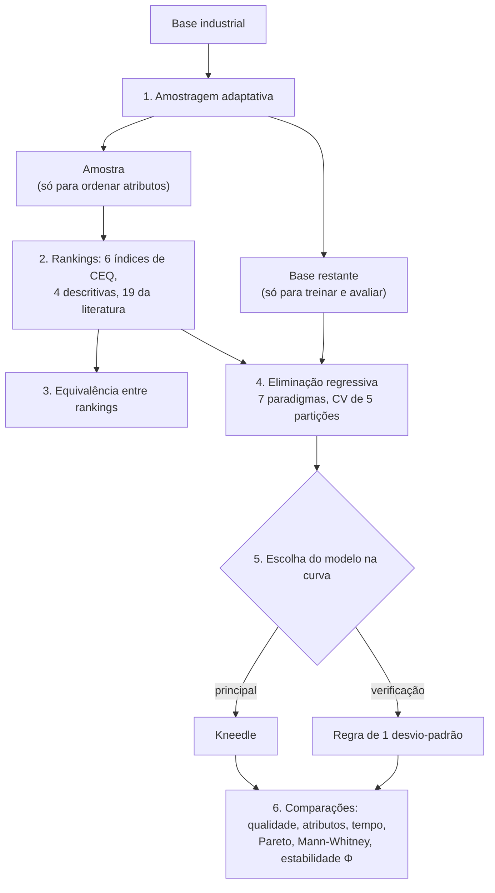

# `spc-feature-selection`: seleção e ordenação de atributos guiadas por Controle Estatístico da Qualidade (CEQ)


> Código e resultados dos dois estudos de caso do artigo *"Integrando o Aprendizado de Máquina e Controle Estatístico da Qualidade: Seleção e Ordenação de Atributos"*, submetido a um periódico em revisão duplo-cega.

> **Aviso sobre os dados do estudo de caso 2 (caminhões).** A base de dados do estudo de caso 2 pertence à empresa que a cedeu e é **confidencial**. Ela **não é pública** e **não está neste repositório**. Quem precisar dela para reproduzir ou ampliar a análise deve entrar em contato com o autor correspondente para **iniciar o processo de solicitação de autorização de liberação dos dados**, que depende da aprovação da empresa. Durante a revisão duplo-cega, o contato é feito por meio do editor do periódico; o endereço do autor correspondente será divulgado após a revisão. A base do estudo de caso 1 (SECOM) é pública e está incluída.

---

## Índice

- [Visão geral](#visão-geral)
- [O método](#o-método)
- [Fluxo](#fluxo)
- [Estrutura do repositório](#estrutura-do-repositório)
- [Os dois estudos de caso](#os-dois-estudos-de-caso)
- [Instalação](#instalação)
- [Como executar](#como-executar)
- [Resultados](#resultados)
- [Disponibilidade dos dados](#disponibilidade-dos-dados)
- [Licença](#licença)

---

## Visão geral

Bases industriais têm muitos atributos (sensores, estados operacionais). Escolher e ordenar esses atributos costuma depender de métodos genéricos de filtro (ANOVA, informação mútua, *ReliefF* etc.). Este repositório implementa uma alternativa: ordenar os atributos com **índices do Controle Estatístico da Qualidade (CEQ)** e comparar essa ordenação com 19 métodos da literatura e 4 estatísticas descritivas, em dois estudos de caso industriais.

A pergunta de pesquisa é se índices de CEQ conseguem orientar a ordenação e a seleção de atributos. O repositório reúne tudo o que é necessário para refazer a análise: os cadernos, a base de entrada do estudo de caso 1 e as planilhas de resultado dos dois estudos (a base de entrada do estudo de caso 2 é confidencial e não está incluída).

## O método

1. **Amostragem adaptativa** (caderno 1): a base é dividida em uma *amostra*, usada só para ordenar os atributos, e uma *base restante*, usada só para treinar e avaliar os modelos. As duas partes não compartilham registros, o que evita o viés de seleção.
2. **Rankings** (caderno 2): seis índices de CEQ (Cp, Cpk, Pp, Ppk, p, c), 4 estatísticas descritivas e 19 métodos da literatura. Os limites LSL e USL dos índices de capacidade são os percentis 1 e 99 de cada atributo na classe de referência.
3. **Equivalência entre rankings** (caderno 3): testes de Friedman e Nemenyi e correlação de Spearman.
4. **Eliminação regressiva** (caderno 4): para cada ranking, remove-se o pior atributo a cada passo e avalia-se o modelo por validação cruzada estratificada de 5 partições (semente 42), em sete paradigmas com hiperparâmetros padrão: Árvore de Decisão, Floresta Aleatória, *Gradient Boosting*, SVM, Perceptron Multicamadas, Naive Bayes Gaussiano e Regressão Logística (L1).
5. **Escolha do modelo em cada curva** (caderno 5): critério *Kneedle* (principal) e regra de um desvio-padrão (verificação).
6. **Comparações** (cadernos 5 a 9): qualidade, número de atributos, tempo, fronteira de Pareto, teste de Mann-Whitney e estabilidade dos rankings (índice Φ de Nogueira, 100 subamostras estratificadas de 50%).

## Fluxo



## Estrutura do repositório

```text
.
├── README.md
├── LICENSE
├── requirements.txt
├── EC1_SECOM/                  # Estudo de caso 1: fabricação de semicondutores (binário)
│   ├── EC1_README.md
│   ├── codigo/                 # cadernos 1 a 9
│   ├── dados/                  # base de entrada (uci-secom.xlsx)
│   └── resultados/             # planilhas, figuras e tabelas geradas
└── EC2_Caminhoes/              # Estudo de caso 2: caminhões fora de estrada (5 turmas)
    ├── EC2_README.md
    ├── codigo/                 # cadernos 1 a 8, adaptados do EC1
    ├── dados/                  # instruções de acesso (base confidencial, não publicada)
    └── resultados/             # planilhas, figuras e tabelas, uma subpasta por turma
```

Cada estudo de caso é independente: tem os próprios cadernos, dados e resultados. Os arquivos de código levam o prefixo `EC1_` ou `EC2_`.

## Os dois estudos de caso

O método é o mesmo nos dois. A única diferença é a estrutura das classes.

| | **EC1: SECOM** | **EC2: Caminhões** |
|---|---|---|
| Domínio | Fabricação de semicondutores | Operação de caminhões fora de estrada em mina a céu aberto |
| Registros | 1.567 unidades (1.463 conformes, 104 falhas) | 7.936 turnos de 6 horas |
| Atributos | 590 sensores | 106 estados operacionais (tempo, em segundos, em cada estado) |
| Classes | 2 (conforme / falha) | 5 turmas de operação (A a E) |
| Classe de referência | Unidades conformes | Cada turma, em um cenário próprio (5 cenários) |
| Métricas | Acurácia balanceada, sensibilidade, especificidade, AUC | Acurácia balanceada, AUC macro, F1 macro |
| Rankings × paradigmas | 29 × 7 | 29 × 7 em cada um dos 5 cenários |

No EC2 não há classe conforme: cada turma faz o papel de classe de referência no seu cenário, e os classificadores continuam prevendo as cinco turmas. Sensibilidade e especificidade não se aplicam a cinco classes.

## Instalação

```bash
git clone <URL-DESTE-REPOSITORIO>
cd spc-feature-selection

python -m venv venv
source venv/bin/activate          # Windows: venv\Scripts\activate
pip install -r requirements.txt
```

## Como executar

Os cadernos leem e gravam na pasta atual. Por isso, para refazer um estudo de caso, copie o código e os dados para uma pasta de trabalho:

```bash
mkdir trabalho
cp EC1_SECOM/codigo/* EC1_SECOM/dados/* trabalho/     # ou EC2_Caminhoes/...
cd trabalho
jupyter lab
```

Execute os cadernos na ordem numérica (1, 2, 2_2, 3, 4, 5, 6, 7, 8 e, no EC1, 9). As planilhas geradas ficam em `trabalho/`; a pasta `resultados/` de cada estudo de caso guarda as planilhas que acompanham o artigo. O passo 4 (eliminação regressiva) é o mais demorado: o número de modelos treinados é `rankings × paradigmas × atributos × 5 partições` (e ainda multiplicado por 5 cenários no EC2). Ajuste `n_jobs` ao número de núcleos disponíveis.

## Resultados

Cada pasta `resultados/` traz as planilhas `Ranking_*.xlsx`, as curvas de eliminação regressiva por paradigma (`Modelos*_CV_Consolidado.xlsx`), o resumo global, as tabelas em LaTeX e as figuras de Pareto. Os números do artigo e a forma de reproduzi-los estão descritos no README de cada estudo de caso.

## Disponibilidade dos dados

- **Estudo de caso 1 (SECOM):** base pública, em `EC1_SECOM/dados/`.
- **Estudo de caso 2 (caminhões):** a base pertence à empresa que a cedeu e é confidencial. Ela não é pública, e os arquivos com registros individuais (a base e as amostras) foram removidos. Para obter acesso, é preciso contatar o autor correspondente e solicitar a abertura do processo de autorização de liberação dos dados junto à empresa; durante a revisão, o contato é feito por meio do editor do periódico. As planilhas em `EC2_Caminhoes/resultados/` são agregadas e não contêm registros individuais.

## Licença

Distribuído sob a licença MIT. Veja o arquivo [LICENSE](LICENSE).
